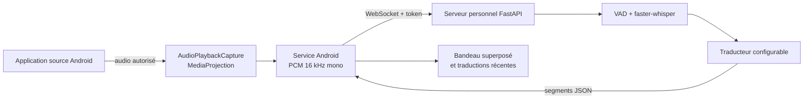

<div align="center">

# AudioLens

**Écoutez dans une langue. Comprenez dans une autre.**

Transcription et traduction de l'audio d'applications Android, affichées en surimpression grâce à un serveur personnel.

[Prise en main](#prise-en-main) · [Fonctionnalités](#fonctionnalités-et-état) · [Architecture](#architecture) · [Développement](#développement-et-tests) · [Documentation](#documentation)

</div>

AudioLens est un projet open source en cours de développement. Son application Android capte les flux audio que le système et l'application source autorisent ; un serveur personnel les transcrit avec **faster-whisper**, puis peut les traduire avec un moteur configurable. Le résultat s'affiche au-dessus de l'application que vous utilisez.

Une vidéo Telegram contenant de la parole russe a été transcrite et traduite en français lors d'un essai sur un téléphone du projet. Ce résultat ne garantit pas la compatibilité de toutes les applications, langues ou versions d'Android.

> **État du dépôt :** `main` est la version de référence fonctionnelle ; `dev` contient les développements et correctifs récents. Ce README décrit `dev`. Certaines fonctions de `dev` restent à valider sur appareil avant d'être considérées comme fiables en usage quotidien.

## Le parcours en un regard

1. Ouvrez **AudioLens** et renseignez l'adresse et le token du serveur personnel dans les réglages.
2. Autorisez l'affichage par-dessus les autres applications, puis touchez **Démarrer la capture**.
3. Accordez les permissions demandées et choisissez l'application source dans le sélecteur Android lorsqu'il est proposé.
4. Dans cette application, par exemple Telegram, lancez normalement la vidéo ou le contenu audio.
5. Lisez la traduction dans le bandeau superposé. Arrêtez la capture depuis AudioLens ou sa notification.

Android contrôle le consentement et les sources capturables. AudioLens n'extrait pas directement les messages des applications et ne contourne pas leurs protections.

## Fonctionnalités et état

| Fonction | État sur `dev` | Précisions |
|---|---|---|
| Capture de lecture Android | Implémenté | `MediaProjection` et `AudioPlaybackCapture` ; disponibilité selon la source et Android. |
| Transcription et traduction | Implémenté | faster-whisper côté serveur ; traduction séparée selon le moteur configuré. |
| Interface Android | Implémenté | Jetpack Compose / Material 3, thèmes clair et sombre, états et réglages. |
| Bandeau superposé | Implémenté | Déplaçable, position mémorisée ; taille du texte et opacité réglables pour la prochaine capture. |
| Traductions récentes | Implémenté | Jusqu'à 100 segments en mémoire pendant la vie du processus ; pas d'historique persistant. |
| Live | Implémenté | Segmentation au fil de l'eau ; le serveur peut émettre des partiels, mais le bandeau affiche les segments finaux. |
| Clip | Partiel | Audio accumulé jusqu'à l'arrêt, puis résultat final ; limité par la durée maximale serveur et à valider sur davantage d'appareils et contenus. |
| Arrêt et réseau | Partiel | Fin de session attendue jusqu'à 60 s ; saturation ou échec signalé. Pas de reconnexion automatique. |
| WAV de diagnostic | Implémenté | Désactivé par défaut ; activation explicite dans les réglages. |
| Import par partage Android | Prévu | L'endpoint serveur `/transcribe` existe ; l'application n'expose pas encore de parcours de partage. |
| Mesure de latence | Partiel | Instrumentation facultative et benchmark synthétique ; pas de mesure complète parole → écran. |

Une capture ou une connexion peut échouer. Le client borne sa file WebSocket : en cas de saturation ou d'envoi refusé, il arrête la capture et signale que de l'audio n'a pas été envoyé. Il ne reprend pas automatiquement après une coupure. À l'arrêt, il attend les résultats restants et la fermeture du serveur, dans la limite de 60 secondes ; une interruption du processus par Android peut empêcher cette finalisation.

## Architecture



L'audio circule en PCM 16 bits, mono, 16 kHz. Le serveur détecte la parole, transcrit et produit des segments. Le moteur de traduction peut être désactivé (`none`) ou configuré avec un adaptateur OpenAI-compatible, Ollama, NLLB ou Argos ; leurs dépendances, modèles et services ne sont pas tous installés par défaut. Si aucune traduction n'est disponible, le client peut afficher le texte source. Le protocole et ses limites sont décrits dans [docs/protocol.md](docs/protocol.md).

## Compatibilité et limites

| Contexte | Ce que l'on sait |
|---|---|
| Android | Minimum Android 11 / API 30 ; compilation et cible API 36. Les différences entre versions et constructeurs nécessitent des tests sur appareil. |
| Telegram | Une vidéo a été capturée et traduite lors d'un essai réel ; voir [la matrice de compatibilité](docs/compatibility.md). |
| WhatsApp et autres applications | Dépendent du contenu, du mode de lecture et des politiques de capture ; aucune compatibilité générale n'est garantie. |
| DRM, appels et certains flux VoIP | Le contenu peut être protégé, exclu par l'application source ou inaccessible à la capture Android. |
| Langues et qualité | La reconnaissance et la traduction dépendent des modèles, du moteur, de la langue, du bruit et du contexte. |
| Réseau | Le téléphone doit pouvoir joindre le serveur ; le trafic `ws://` n'est pas chiffré par AudioLens lui-même. |

L'accès au microphone demandé par Android est nécessaire à `AudioPlaybackCapture`, même si ce parcours capture la lecture audio plutôt que le microphone. La permission de superposition est distincte ; celle des notifications dépend de la version Android.

## Prise en main

### Prérequis

- Un téléphone Android 11 ou supérieur et un ordinateur Linux capable d'exécuter Python 3.11 ou supérieur.
- Sur l'ordinateur : `git`, `python3`, l'outil de création de venv et `ffmpeg` pour l'endpoint de fichier. Une connexion peut être nécessaire pour installer les dépendances et télécharger les modèles manquants.
- Pour compiler Android : JDK 17, SDK Android avec plateforme API 36 et outils de compilation, ainsi que le wrapper Gradle fourni.
- Un moteur de traduction disponible si vous souhaitez traduire : l'exemple serveur commence avec `translation.engine: none`.
- Un chemin réseau privé entre téléphone et serveur. Pour un premier essai avec le téléphone connecté en USB, `adb reverse` permet d'utiliser `localhost` sans exposer le serveur sur le réseau local.

### 1. Installer et configurer le serveur

```bash
git clone https://github.com/nikodindon/AudioLens.git
cd AudioLens
git switch dev
cd server
python3 -m venv .venv
source .venv/bin/activate
python -m pip install -e '.[dev]'
cp config.example.yaml config.yaml
openssl rand -hex 16
```

Copiez la valeur générée dans `server.token` de `config.yaml`, fichier local ignoré par Git. Ne partagez ni ce token ni vos clés. Le modèle par défaut est `small` ; le premier chargement peut télécharger ses fichiers. Pour un essai CPU moins exigeant, vous pouvez choisir `base` et `device: cpu` dans la configuration.

L'exemple n'active **aucune traduction**. Pour utiliser un service HTTP compatible avec l'API de chat OpenAI, ajoutez ou adaptez les champs suivants dans la section `translation` de votre fichier local :

```yaml
translation:
  engine: openai
  target_lang: fr
  openai_base_url: "http://127.0.0.1:8080/v1"  # exemple : service à démarrer séparément
  openai_model: "nom-du-modele-disponible"
  # openai_api_key: "votre-cle-si-necessaire"
```

L'adresse et le nom du modèle sont des exemples : remplacez-les par ceux de votre propre moteur. Avec cette configuration, les textes transcrits sont envoyés à ce service ; choisissez son emplacement en conséquence. Les adaptateurs Ollama, NLLB et Argos nécessitent leur propre configuration ; NLLB/Argos demandent aussi des dépendances ou modèles supplémentaires. Voir [config.example.yaml](server/config.example.yaml) et [le code des adaptateurs](server/app/translate/).

Pour utiliser un GPU NVIDIA compatible, l'extra facultatif `python -m pip install -e '.[dev,gpu]'` installe des bibliothèques supplémentaires volumineuses. Après installation, `source scripts/gpu_env.sh` configure leur recherche pour le processus courant. Sinon, le serveur peut utiliser le CPU selon sa configuration.

Démarrez le serveur depuis `server/` :

```bash
python -m app.main --config config.yaml
```

Dans un autre terminal sur le serveur :

```bash
curl http://127.0.0.1:8765/health
```

La réponse indique notamment le modèle, le périphérique et le moteur de traduction déclarés. Elle ne garantit pas que le service de traduction externe est joignable ou que la capture Android fonctionne. Le serveur doit être démarré séparément de l'application.

### 2. Compiler l'application Android

```bash
cd ../android                     # depuis server/
./gradlew :app:assembleDebug
```

L'APK est généré dans `android/app/build/outputs/apk/debug/app-debug.apk`. La variante debug s'appelle **AudioLens Dev** et porte l'identifiant `dev.audiolens.dev`, distinct de l'identifiant de base `dev.audiolens`. Cela permet une installation côte à côte, sous réserve qu'aucune autre application n'utilise déjà cet identifiant. Installer un APK reste une action volontaire sur l'appareil ; une compilation réussie ne valide pas la capture réelle.

### 3. Connecter le téléphone et démarrer

Pour un essai USB avec ADB disponible et un téléphone autorisé :

```bash
adb devices
adb reverse tcp:8765 tcp:8765
```

Dans **AudioLens Dev → Réglages**, saisissez `http://localhost:8765` comme adresse et le même token que côté serveur, puis vérifiez la langue cible et le mode. Autorisez la superposition, revenez à l'accueil et démarrez la capture. Après le consentement Android, ouvrez le contenu à écouter.

Pour un usage sans USB, vous pouvez utiliser un réseau privé tel que Tailscale et faire écouter le serveur sur l'interface appropriée. La configuration réseau Android autorise le `ws://` en clair seulement pour les hôtes explicitement listés dans [network_security_config.xml](android/app/src/main/res/xml/network_security_config.xml) : une autre adresse peut nécessiter une adaptation et une recompilation, ou une solution `wss://` correctement configurée. Les réglages réseau du serveur et les ACL restent sous votre contrôle ; n'exposez pas le service sur Internet public.

## Modes et données

**Live** segmente le flux et transmet les résultats finaux au fur et à mesure. **Clip** conserve l'audio de la session jusqu'à l'arrêt, puis demande une transcription finale ; la durée admissible dépend de `server.max_audio_seconds`. Un clip long consomme davantage de mémoire et peut dépasser le délai d'attente Android.

Le WAV de diagnostic est désactivé par défaut. Si vous l'activez dans les réglages, un fichier est écrit dans le stockage privé de l'application ; il peut contenir des conversations et est remplacé lors d'une capture de diagnostic ultérieure. Désactiver l'option ne supprime pas un fichier déjà créé.

Le mode fichier du serveur utilise temporairement le disque pour convertir l'entrée via FFmpeg. L'historique Android est en mémoire seulement. Les journaux usuels sont conçus pour éviter les textes et les secrets, mais protégez les anciens journaux et les fichiers de configuration ; ils peuvent provenir de versions antérieures. Les mesures facultatives sont décrites dans le [rapport de latence](docs/benchmark-streaming-report.md).

## Développement et tests

Depuis la racine du dépôt :

```bash
cd server
source .venv/bin/activate
python -m pytest -q
ruff check app tools tests
ruff format --check app tools tests
mypy
```

```bash
cd ../android
./gradlew :app:assembleDebug :app:testDebugUnitTest --no-daemon
```

Avec les dépendances déjà en cache, ajoutez `--offline` à Gradle. Les tests Python incluent des moteurs simulés et les tests Android incluent un serveur WebSocket local simulé ; ils ne remplacent pas une vérification sur appareil avec contenu autorisé. GitHub Actions exécute ces vérifications sur les pushs vers `main` et `dev`, ainsi que sur les pull requests ; le workflow ne déploie pas l'application.

Pour développer, partez de `dev` ou créez une branche de fonctionnalité depuis `dev`, puis proposez des changements ciblés. Ne fusionnez pas vers `main` sans validation explicite du responsable du projet. Ne commitez pas `server/config.yaml`, les tokens, les modèles téléchargés ni les données privées.

## Roadmap

### Implémenté

- Capture Android autorisée, service au premier plan, WebSocket et bandeau de traduction.
- Serveur FastAPI, faster-whisper, segmentation VAD et adaptateurs de traduction configurables.
- Réglages, affichage des résultats récents en mémoire et option WAV de diagnostic.
- Tests automatisés, compilation Android debug et CI sur `main` / `dev`.

### Partiellement implémenté ou à valider

- Mode clip et finalisation après arrêt sur des durées et appareils variés.
- Gestion des interruptions et de la saturation ; la reconnexion automatique n'existe pas encore.
- Instrumentation et benchmark synthétique ; mesure complète de latence et consommation batterie à réaliser.
- Compatibilité réelle par application, version Android, type de média et moteur de traduction.

### Prévu

- Import Android de fichiers par partage et expérience de consultation associée.
- Amélioration de la robustesse réseau et validation de sessions longues.
- Optimisation progressive de la latence après mesures sur une instance isolée.
- Historique persistant et export, si retenus après étude de confidentialité.

## Documentation

- [Protocole WebSocket et API](docs/protocol.md)
- [Compatibilité de capture](docs/compatibility.md) · [Appareil de test](docs/device.md)
- [Dépannage](docs/troubleshooting.md) · [Journal historique des décisions](docs/decisions.md)
- [Analyse de latence](docs/streaming-latency.md) · [Rapport de benchmark synthétique](docs/benchmark-streaming-report.md) · [Benchmark Whisper historique](docs/benchmark.md)

## Licence

AudioLens est distribué sous la [licence MIT](LICENSE).
